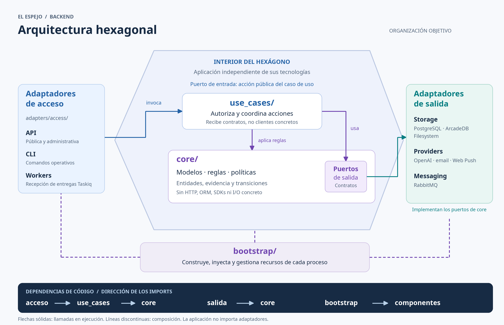

# Arquitectura del backend

Organización vigente al 2026-10-26 para el alcance migrado: núcleo, aplicación,
adaptadores y composición separados y validados con motores aislados e imagen de
producción. La gestión de ejes continúa en migración; los comandos externos
que siguen en uso mantienen puentes mínimos documentados. El
[mapa](docs/development/repository-map.md) ubica las implementaciones actuales.

Este documento es la referencia de responsabilidades, dependencias y crecimiento
del backend. [AGENTS.md](AGENTS.md) contiene instrucciones de trabajo; los contratos
de cada funcionalidad están en el [índice](docs/README.md).

## Modelo hexagonal

El interior del hexágono comprende **core y casos de uso**. Los adaptadores quedan
fuera: traducen tecnologías concretas al lenguaje de la aplicación. Bootstrap
construye y conecta los componentes al iniciar cada proceso.



[Ampliar PNG](docs/assets/hexagonal-architecture.png) ·
[SVG editable](docs/assets/hexagonal-architecture.svg) ·
[Generador](scripts/render_architecture_diagram.py)

Las flechas sólidas muestran llamadas en ejecución; las líneas discontinuas,
composición. La franja inferior indica las dependencias de código, que apuntan
hacia el interior. Los puertos de salida están dentro de `core`.

Para regenerar las dos imágenes: `python3 scripts/render_architecture_diagram.py`.
La herramienta documental usa Pillow y una fuente Noto Sans o DejaVu Sans; no
importa la aplicación ni necesita servicios o acceso a la red.

La llamada en ejecución atraviesa el puerto hacia el adaptador de salida, pero
la aplicación no importa ese adaptador: depende del contrato y recibe una
implementación. Esa inversión de dependencia es la frontera esencial.
El hexágono no representa seis módulos, seis capas ni un número de servicios.
Seguimos teniendo un backend con varios procesos, no una propuesta de microservicios.

Un puerto de entrada puede ser el método público de un caso de uso con su comando
y resultado tipados; no exige una interfaz adicional por cada endpoint. Un puerto
de salida describe una necesidad de la aplicación, por ejemplo guardar un original,
obtener un artefacto o aceptar un trabajo durable. Un cliente HTTP o una sesión SQL
no constituyen ese contrato.

## Estructura de responsabilidades

```text
src/                              # Backend; organización por responsabilidades
├── core/                         # Modelos, reglas y contratos internos
│   ├── domain/                   # Document, AudioNote y valores compartidos
│   ├── documents/                # Reglas y puertos propios de documentos
│   ├── audio/                    # Originales, preparación y puerto de transcripción
│   ├── graph/                    # Contratos de navegación y proyecciones de lectura
│   ├── processing/               # Estados, transiciones y contratos durables
│   ├── extractors/               # Perfiles, resultados, evidencia y puertos
│   ├── notifications/            # Vigencia y reglas del centro de notificaciones
│   ├── workspaces/               # Identidad, alcance y disponibilidad del espacio
│   ├── auth/                     # Identidad, contraseñas, sesiones y recuperación
│   ├── exteriorization/          # Invitaciones, horarios y consentimiento
│   ├── administration/           # Contratos de inventario, métricas y permisos
│   └── maintenance/              # Hechos y puertos de migraciones operativas
├── use_cases/                    # Acciones de aplicación y coordinación por puertos
│   ├── documents/                # Aceptar, consultar, borrar y respaldar notas
│   ├── audio/                    # Aceptar audio y obtener su documento derivado
│   ├── processing/               # Coordinar jobs, checkpoints, retry y reprocess
│   ├── extraction/               # Ejecutar extractores y recuperar persistencia
│   ├── personal_axes/            # Definir, evaluar y explorar ejes; Laboratorio
│   ├── graph/                    # Consultar proyecciones y verificar originales
│   ├── notifications/            # Consultar y marcar notificaciones leídas
│   ├── workspaces/               # Preparar, resolver y reconciliar espacios
│   ├── auth/                     # Login, recuperación y revocación de sesiones
│   ├── exteriorization/          # Configurar, programar y enviar invitaciones
│   ├── administration/           # Consultar inventario y administrar permisos
│   └── maintenance/              # Coordinar backups, cutover y recuperación
├── adapters/                     # Entrada/salida y tecnologías concretas
│   ├── access/                   # Traducir entradas externas a casos de uso
│   │   ├── api/                  # HTTP: rutas, schemas y traducción de errores
│   │   │   ├── public/           # Endpoints de la aplicación pública
│   │   │   └── administration/   # Endpoints exclusivos del proceso admin
│   │   ├── cli/                  # Comandos operativos y de mantenimiento
│   │   └── workers/              # Recibir entregas Taskiq y gestionar ACK
│   ├── storage/                  # Implementar persistencia por capacidad
│   │   ├── arcadedb/             # Esquemas, consultas y proyecciones del grafo
│   │   ├── postgres/             # ORM, transacciones, leases, locks y outbox
│   │   └── filesystem/           # Originales, artefactos y archivos durables
│   ├── providers/                # Integraciones con servicios externos
│   │   ├── openai/               # Extracción, embeddings y transcripción
│   │   ├── email/                # Entrega de correo y traducción de fallos
│   │   ├── security/             # Cifrado y protección de credenciales técnicas
│   │   ├── web_push/             # Envíos push y respuestas del proveedor
│   │   └── telemetry/            # Diagnósticos filtrados y trazas técnicas
│   └── messaging/                # Transporte de mensajes de procesamiento
│       └── rabbitmq/             # Publicación, cola y confirmación del broker
└── bootstrap/                    # Construir, conectar y cerrar componentes
    ├── settings.py               # Leer y validar configuración del entorno
    ├── public_dependencies.py    # Inyectar casos de uso a las rutas públicas
    ├── public_router.py          # Registrar endpoints y dependencias de sesión
    ├── public_api.py             # Aplicación pública y ciclo de vida
    ├── administration.py         # Aplicación administrativa independiente
    ├── worker.py                 # Componer worker, tareas y cierre de recursos
    ├── dispatcher.py             # Componer despacho durable y programadores
    └── data_migrations.py        # Conectar CLI, puertos y recursos de mantenimiento
```

Es un esquema de ubicación, no una orden de crear carpetas vacías. Cada área
crece cuando existe una responsabilidad concreta. Dentro de un adaptador técnico
se agrupa por capacidad: por ejemplo `storage/arcadedb/extractors/emotions.py`.
Tener varios repositorios de una tecnología no implica un único store universal.

## Responsabilidad de cada capa

| Capa | Responsabilidad | Ejemplos | Fuera de su responsabilidad |
| --- | --- | --- | --- |
| `core/domain` | Entidades y valores compartidos con una definición canónica | Documento, audio original e identidad de recurso | Modelos ORM, request/response HTTP, rutas de archivos de un adaptador |
| `core/<área>` | Modelos específicos, reglas, políticas, errores semánticos y puertos | Evidencia válida, configuración aceptada, transiciones de trabajo, contratos de almacenamiento | SQL/Cypher, DDL, SDKs, variables de entorno, publicación RabbitMQ |
| `use_cases/<área>` | Ejecutar una acción, autorizarla y coordinar operaciones por puertos | Aceptar nota, reintentar procesamiento, recuperar contraseña, programar invitación | Detalles HTTP, sesiones/modelos ORM, construcción de clientes, settings globales |
| `adapters/access` | Traducir entrada externa y resultado del caso de uso | Cookies, schemas HTTP, UUID del mensaje, parámetros CLI, códigos HTTP, ACK | Decisiones de negocio o consultas SQL de la funcionalidad |
| `adapters/storage` | Implementar persistencia y consultas por capacidad | ORM, transacciones SQL, consultas ArcadeDB, publicación durable de archivos | Elegir la política del producto o reinterpretar la configuración aceptada |
| `adapters/providers` | Traducir llamadas y respuestas de servicios externos | OpenAI, correo y Web Push; normalización de errores del proveedor | Decidir qué trabajo aceptar o qué usuario tiene permiso |
| `adapters/messaging` | Implementar publicación y transporte | Exchange/cola, publisher confirms y envío del mensaje | Decidir reintentos de negocio o convertir el broker en autoridad del estado |
| `bootstrap` | Configurar y ensamblar cada proceso | Settings del entorno, factories, registros, lifespans y cierre de clientes | Reglas de negocio, SQL de funcionalidades o implementación de sus recorridos |

El dominio específico de un área permanece en ella. `core/domain` se reserva para
conceptos realmente compartidos; no se replica Document en cada módulo. Pydantic
es admisible para tipos y validación interna. Sus modelos internos no adquieren
por ello dependencia de FastAPI ni se exponen automáticamente como contrato HTTP.

Los schemas HTTP están en acceso; los modelos ORM, en storage. Los casos de uso
operan con comandos/resultados propios o tipos del núcleo y traducen entre ellos
sin depender de esos schemas ni de objetos ORM ligados a una sesión.

## Reglas de dependencia

| Origen | Puede depender de | No puede depender de |
| --- | --- | --- |
| `core` | Biblioteca estándar, validación y contratos internos explícitos de core | `use_cases`, `adapters`, `bootstrap`, FastAPI, SQLAlchemy, Taskiq, SDKs e implementaciones de I/O |
| `use_cases` | `core` y colaboradores de aplicación explícitos, sin ciclos | Adaptadores, bootstrap, SQL/Cypher, clientes concretos, sesiones ORM o lectura global del entorno |
| Acceso | Casos de uso, tipos de core y su framework de entrada | Implementaciones de storage/proveedores para resolver directamente la funcionalidad |
| Salida | Puertos/tipos de core, su tecnología y utilidades técnicas de su adaptador | Casos de uso, rutas y bootstrap; modelos privados de otra persistencia |
| `bootstrap` | Las capas y tecnologías necesarias para componer | No recibe dependencias desde las capas interiores |

Las dependencias entre áreas son explícitas y sin ciclos. Una acción que afecta
varias capacidades se coordina en aplicación; no se resuelve importando el modelo
SQL privado de otra área. Si se necesita compartir una transacción, se expresa
mediante el contrato transaccional y su implementación común.

La inyección de HTTP/workers se conecta desde bootstrap. Un router no importa
factories de bootstrap para construir su persistencia; recibe el caso de uso o un
resolvedor ya conectado. Los entrypoints son parte de la composición externa.

Los puertos pueden organizarse como `core/<área>/ports.py` o `ports/` según tamaño.
Expresan operaciones semánticas, no `execute_sql`, `get_session` o acceso al cliente
del grafo. Tampoco se pasan implementaciones dentro de diccionarios/contextos para
eludir estas reglas. Los adaptadores traducen fallos técnicos a errores del contrato;
acceso traduce esos errores al protocolo externo.

## Separaciones relevantes para este backend

### Extracción y persistencia

El núcleo define perfil, resultado, evidencia y validez de una extracción. Los
casos de uso coordinan leer el documento, invocar al proveedor, guardar un artefacto
y persistirlo. Los adaptadores implementan cada I/O. La recuperación de persistencia
lee el artefacto y no vuelve a invocar al modelo.

Cada extractor sigue siendo dueño lógico de su capa: su adaptador administra su
esquema y reemplaza atómicamente sólo su proyección. No se concentra SQL de todas
las capas dentro de un store genérico. Los constructores se registran en bootstrap;
el ejecutor común no añade condicionales por cada extractor nuevo.

Un eje definido por el usuario es compatible con este contrato. Sus acciones de
definir, probar y aceptar versiones pertenecen a aplicación; sus reglas y tipos,
al núcleo de extracción, y HTTP/ORM/proveedores a sus adaptadores. El alcance
actual ya separa núcleo, extractor, proveedor y proyección, además de definiciones,
acceso, exploración y el ciclo de previews/aceptación/limpieza. Lotes históricos y
reservas automáticas continúan según su
[plan](docs/development/personal-axes-migration-plan.md),
manteniendo compatibilidad y reglas de versionado/evidencia.

### Procesamiento durable y transacciones

Core define estados, transiciones, identidad, checkpoints y contratos de ejecución.
La aplicación decide aceptación, coordinación padre/hijos, retry y reprocess.
PostgreSQL implementa estado durable, leases, locks y outbox. Taskiq/RabbitMQ
transportan entregas; no agregan otra política de reintentos.

La unidad de trabajo SQL debe confirmar recibo, job, evento y outbox juntos cuando
lo requiere el contrato. Separar repositorios no habilita commits independientes
ni expone `AsyncSession` a la aplicación. Los registros del caso de uso son tipos
de aplicación/core, no modelos ORM retornados fuera de la transacción.

El original y el vértice base se conservan antes de confirmar una aceptación de
documento. Archivos, PostgreSQL y ArcadeDB no comparten transacción: se mantienen
operaciones idempotentes, respaldos y checkpoints. Retry retoma identidad/configuración;
reprocess crea una ejecución nueva. El refactor no modifica estas garantías.

### Identidad, workspaces y procesos

Acceso autentica con el mecanismo del canal y entrega una identidad verificada.
El caso de uso comprueba autorización, propietario y disponibilidad del workspace;
un UUID arbitrario del cliente no elige el almacenamiento. Los adaptadores reciben
el alcance ya resuelto y bootstrap construye clientes acotados y gestiona su cierre.

La API pública y administrativa se ensamblan por separado. Compartir núcleo y
casos de uso no registra automáticamente rutas administrativas en el proceso público.
Las observaciones técnicas se correlacionan sin volcar notas, audio o credenciales.

## Criterios para agregar módulos y funcionalidades

Un módulo es una capacidad con propósito, vocabulario y responsabilidades propias;
no es necesariamente una nueva carpeta en cada capa ni un servicio desplegable.
Antes de añadir uno, comprobar si la responsabilidad ya tiene un dueño.

Crear una nueva área de core cuando tenga reglas/modelos propios y un ciclo de
vida o frontera que pueda explicarse y probarse de forma independiente. Un endpoint
nuevo, otra tabla, otra tecnología o un archivo largo no bastan por sí solos.
Extender el área existente cuando se mantiene el mismo propósito e invariantes.

Para cada funcionalidad nueva:

1. **Definir el resultado y el dueño.** Explicar qué acción o regla agrega, qué
   conceptos usa y qué capacidades existentes consume. No duplicar modelos canónicos.
2. **Ubicar la regla.** Una invariante va a `core/<área>`; la coordinación de una
   acción va a `use_cases/<área>`. Una consulta sin regla adicional no requiere
   crear artificialmente una entidad o un agregado.
3. **Definir sólo los puertos necesarios.** Si necesita I/O, nombrar la operación
   de aplicación y sus tipos/errores. Reutilizar contratos compatibles; no crear
   una interfaz por cada función privada ni repositorios CRUD universales.
4. **Agregar adaptadores donde corresponda.** Rutas y schemas en acceso; SQL,
   grafo y archivos en storage; SDKs en providers. Organizar cada tecnología por
   área. Una integración nueva no crea automáticamente otro dominio.
5. **Componer explícitamente.** Conectar el caso de uso, implementaciones y recursos
   en bootstrap. Si es otro extractor, registrarlo por el contrato común sin
   acoplar el coordinador a su nombre o payload.
6. **Revisar dependencias y recuperación.** No introducir ciclos, imports privados
   de infraestructura ni pérdida de atomicidad. Definir ownership, idempotencia y
   recuperación de efectos parciales cuando existan.
7. **Probar y documentar.** Reglas/casos de uso con puertos falsos; adaptadores con
   sus tecnologías y contratos de entrada. Actualizar el contrato funcional y el
   mapa. Si cambia una frontera arquitectónica, actualizar este documento.

Ejemplos: otra ruta de lectura de documentos amplía el área existente; un nuevo
proveedor de transcripción implementa su puerto; un extractor de temas aporta sus
reglas/tipos y adaptadores bajo extracción. Ninguno necesita un `utils` o `services`
global donde mezclar responsabilidades sin dueño.

## Comprobación y compatibilidad

El [control de imports](docs/development/architecture-checks.md) verifica núcleo,
aplicación y adaptadores, impide nuevas ubicaciones fuera del árbol objetivo y
rechaza excepciones obsoletas. Las capas migradas no requieren excepciones.
El chequeo documental es independiente del control de código.

Un recorrido cumple esta arquitectura cuando puede ejecutar su caso de uso con
puertos falsos sin iniciar FastAPI, ORM, broker o proveedor real. Los adaptadores
devuelven estados independientes del ORM y traducen fallos SQL a `StorageUnavailable`.
Las pruebas de integración comprueban después la atomicidad; los mocks no acreditan
locks, motores o transporte real.

La API pública recibe casos y límites explícitos. SSE consulta sesión y workspace
mediante un puerto, cierra la sesión SQL y vuelve a autorizar en cada heartbeat.
La exportación resuelve originales por dueño/instancia sin abrir el grafo ni
necesitar su disponibilidad. El SDK de diagnóstico recibe configuración desde
bootstrap; HTTP obtiene un callback y no importa proveedores concretos.

Mantenimiento expresa estado durable, recursos de grafo y archivos como puertos.
La aplicación controla checkpoints, dry run, cutover y reanudación. PostgreSQL
implementa locks y reconciliación; ArcadeDB hace borrado transaccional; filesystem
verifica backups/fingerprints, publica con fsync y elimina sólo derivados conocidos.
La comprobación de originales ocurre antes de confirmar el borrado del grafo.
Mover módulos no modifica IDs de migración ni revisiones Alembic aplicadas.

La API administrativa conserva pool/configuración/lifespan independientes. Sus
métricas usan hechos tipados y cobertura desconocida `null`. La bandeja funciona
sin permiso push y comparte transacción con las invitaciones que la originan.
Workspaces conserva principales restringidos por dueño; root se usa para provisión
y mantenimiento administrativo explícito, nunca para servir lecturas públicas.

Ejes mantiene puentes explícitos: preparación/orden de escritura y clasificación
de fallos privados, contexto SQL en workflows experimentales y `AxisHistoryRequests`
para su reset transaccional. `bootstrap/personal_axes.py` configura y cierra sus
proveedores e inyecta los puertos del extractor canónico. El contexto de escritura
es tipado; el binder SQL anterior conserva setters compatibles hasta la etapa 4.
Las definiciones/versiones SQL devuelven estados tipados, sin ORM. Las lecturas
del grafo ofrecen operaciones semánticas mediante un puerto; aplicación verifica
propiedad, originales, hashes, procedencia y cursores. HTTP recibe casos inyectados
y traduce errores semánticos. `bootstrap/{laboratory,personal_axes_reads,personal_axes_api}.py`
compone esos recorridos; el histórico anterior delega la cobertura al lector nuevo.
Previews usa puertos de temporales y reserva SQL: aplicación guarda primero el
input inmutable, después confirma job/recibo/outbox en una sola unidad de trabajo.
El adaptador conserva cuota, locks y reloj SQL; aplicación decide vigencia y
recuperación. Su worker no necesita sesiones ni paths; la limpieza separa política
de expiración, selección SQL y escaneo/borrado filesystem. Sólo el histórico
conserva el contexto SQL especial en el ejecutor común. Estos puentes se retiran
al migrar histórico y reservas automáticas.

Los entrypoints antiguos aún usados por `mirror-deploy` sólo delegan a bootstrap.
Su consumidor, motivo y condición de retiro constan en el [mapa](docs/development/repository-map.md)
y la [política](config/architecture-exceptions.json). Mantenerlos permite actualizar
los comandos externos en otra entrega autorizada, sin duplicar implementaciones.
