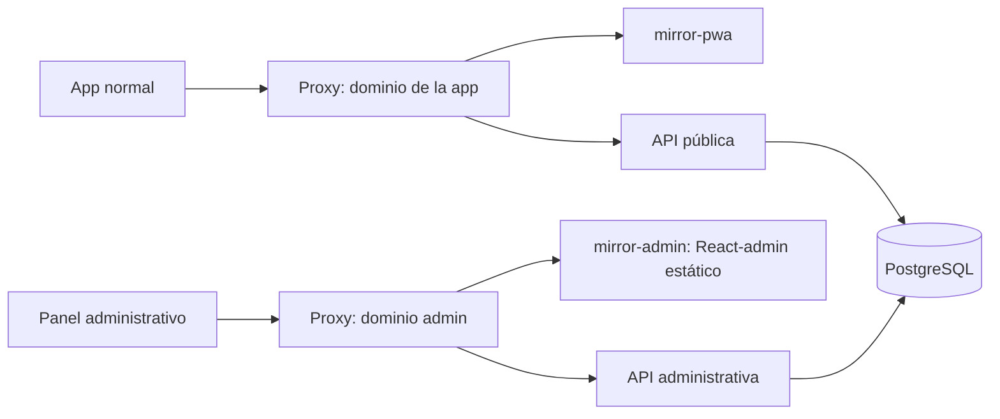

# Prototipo de administración de El Espejo

Abrir `index.html` en un navegador. No requiere instalación ni conexión de red.

Mockup HTML/CSS/JavaScript para validar navegación, jerarquía y contenido antes de implementar con React-admin. No utiliza React-admin todavía. Todos los datos son ficticios; las métricas son ilustrativas y no constituyen una serie analítica real.

Incluye Dashboard con selector de período, Usuarios con búsqueda y filtro de estado, detalle de cuenta, Procesamientos y Auditoría. Las mutaciones administrativas futuras están deshabilitadas. La tabla tiene desplazamiento horizontal propio en pantallas pequeñas.

## Arquitectura propuesta

- Dos procesos y contenedores FastAPI desde el mismo código o imagen: el entrypoint público no registra rutas administrativas; el administrativo no registra rutas funcionales de la PWA.
- Reutilizar casos de uso y contratos de `mirror-core`. No duplicar reglas ni introducir llamadas HTTP a la API pública para cada operación de administración. Los trabajos largos se despachan mediante el mecanismo durable existente.
- Un contenedor estático de React-admin. El navegador llama a `/api/admin/*` en su propio dominio; el proxy reenvía a la API administrativa por una red Docker privada. El JavaScript no puede resolver directamente nombres internos Docker.
- El proxy público rechaza el espacio administrativo y envía la API normal exclusivamente al proceso público. El proxy administrativo permite únicamente los endpoints necesarios para autenticación administrativa y administración. Rechazar hosts desconocidos. Ninguna API publica puertos directamente a Internet.
- Separar redes públicas y administrativas en Docker y limitar participantes. Esto reduce alcance de acceso interno; no sustituye la autorización en cada endpoint.
- Misma identidad, sesiones distintas. Tokens administrativos con ámbito explícito `admin`, TTL propio y revocación, verificados por el backend administrativo. Una sesión pública no adquiere permisos administrativos por cambiar el nombre de su cookie.
- Cookie administrativa de producción `__Host-el_espejo_admin_session`: Secure, HttpOnly, Path=/, sin Domain. No compartir cookies entre subdominios. No guardar tokens administrativos en localStorage.
- Roles asignados solo por operación privilegiada. Empezar con `analyst` (lectura) y `admin` (acciones autorizadas), traducidos a permisos explícitos por operación. Los esquemas públicos de registro y perfil no aceptan ni modifican roles.
- Consultar rol y estado vigentes por petición; revocar acceso ante bloqueo o retiro de rol. Primer administrador por CLI controlada. No implementar un editor genérico de todas las columnas de usuario.
- Validación exacta de Origin y protección CSRF para mutaciones, incluido el login según su flujo. No depender de SameSite ni de CORS como autorización: los subdominios pueden compartir el mismo sitio.
- El panel trabaja con metadatos y agregados. No exponer hashes, tokens, credenciales de workspace, contenido, títulos o audio. Limitar permisos PostgreSQL según operaciones y evitar montar los archivos originales en el contenedor administrativo. Una carga inicial de métricas se ejecuta como proceso controlado separado.
- Auditoría de mutaciones con actor, objetivo, fecha, motivo y resultado. Confirmación de acciones sensibles. MFA recomendado antes de habilitar cambios administrativos en producción.
- El subdominio puede descubrirse por DNS o certificados. La seguridad debe mantenerse aunque se conozcan el dominio y las rutas. Para ocultar además la interfaz, agregar acceso por VPN o un gateway de identidad como capa opcional.

## Validación futura de la implementación

1. API pública: `/api/admin/*` no existe, incluso accediendo directamente al contenedor en una prueba interna; OpenAPI público no contiene operaciones administrativas.
2. API administrativa: sin sesión, sesión pública o sesión de usuario sin rol no obtiene acceso. Una sesión pública de un administrador tampoco sirve como sesión administrativa.
3. Registro y perfil no permiten elevar privilegios, incluso enviando manualmente `roles`, `is_superuser` o campos equivalentes.
4. Analista puede leer métricas pero no ejecutar mutaciones; rol retirado y cuenta bloqueada pierden acceso sin esperar a que expire una sesión.
5. Una solicitud desde la PWA u otro origen no puede ejecutar mutaciones administrativas. Validar protección CSRF, cookies y callbacks de autenticación.
6. Ningún endpoint de métricas o usuarios devuelve notas privadas, audio, tokens, hashes ni credenciales de workspace.
7. Conteos soportan reintentos, importaciones, borrados y reconciliación sin duplicar documentos ni confundir procesamientos con notas.

Propuesta únicamente. No se modificaron rutas, autenticación ni despliegue de la plataforma.
